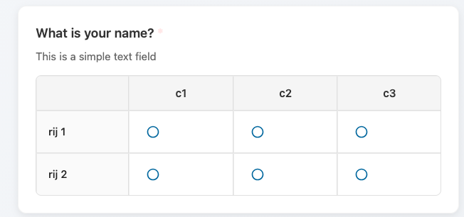
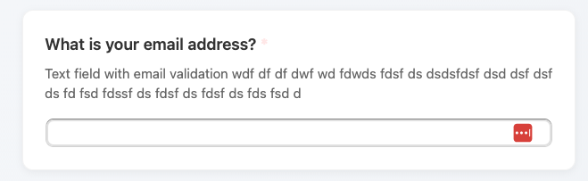
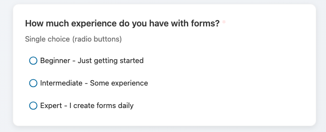
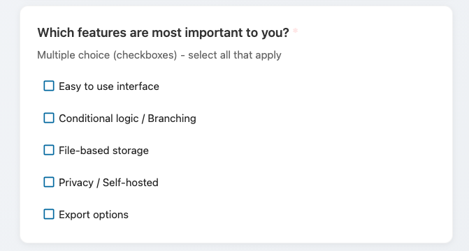
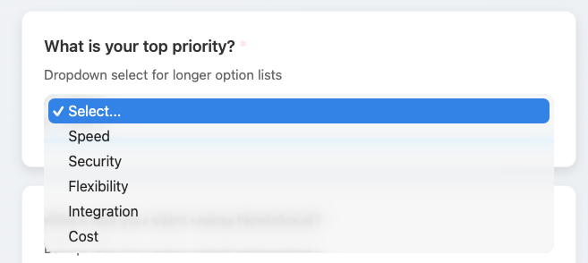
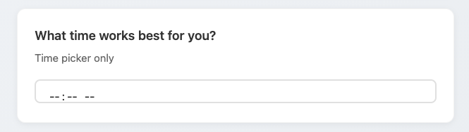
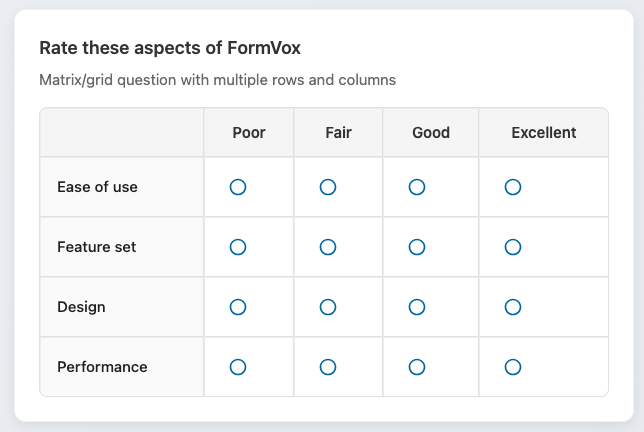
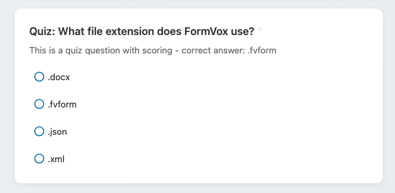

# Question Types

FormVox supports a wide variety of question types to collect different kinds of data. This guide explains each type and when to use it.

## Text Questions

### Short Text
Single-line text input for brief answers like names or titles.

**Use for:** Names, titles, short answers
**Validation:** Optional character limit

### Email
Text input with email validation.

**Use for:** Collecting email addresses
**Validation:** Must be a valid email format

### Multi-line Text (Textarea)
Large text area for longer responses.

**Use for:** Comments, feedback, detailed answers
**Settings:** Adjustable number of rows

## Choice Questions

### Single Choice (Radio)
Select one option from a list.

**Use for:** Yes/no questions, selecting one option
**Settings:**
- Add/remove options
- "Other" option with text input
- Randomize option order

### Multiple Choice (Checkbox)
Select multiple options from a list.

**Use for:** Selecting multiple items, multi-select preferences
**Settings:**
- Add/remove options
- Minimum/maximum selections
- "Other" option with text input

### Dropdown Select
Select one option from a dropdown menu.

**Use for:** Long lists of options, saving space
**Settings:** Same as single choice

## Date and Time Questions

### Date Picker
Select a date from a calendar.

**Use for:** Birthdates, event dates, deadlines
**Settings:**
- Minimum/maximum date
- Date format

### Time Picker
Select a time.

**Use for:** Appointment times, schedules
**Settings:** 12-hour or 24-hour format

### DateTime Picker
Select both date and time.

**Use for:** Event scheduling, appointments with specific times

## Rating Questions

### Linear Scale
Rate on a numeric scale (e.g., 1-5, 1-10).

**Use for:** Satisfaction ratings, agreement scales, NPS
**Settings:**
- Minimum and maximum values
- Labels for endpoints (e.g., "Not satisfied" to "Very satisfied")

### Star Rating
Visual star-based rating.

**Use for:** Product reviews, experience ratings
**Settings:** Number of stars (typically 5)

## File Questions

### File Upload
Allow respondents to upload files with their response.

**Use for:** Document submissions, photo uploads, attachments
**Settings:**
- Allowed file types (e.g., PDF, images, documents)
- Maximum file size limit (per question; 10 MB if not set, 100 MB at most)
- Maximum number of files (per question; 20 at most)

**Limits respondents may run into:**
- A single file over the question's size limit is refused, with the limit named in the error.
- One response's file questions together take at most `3 × (files the questions allow) + 5` files across all of them;
  this leaves room for a retry whose answer got lost and for files replaced after a failed attempt.
- The server's own PHP upload limits (`upload_max_filesize`, `post_max_size`) apply underneath FormVox's own limit;
  whichever is smaller wins.

**Security:**
- Uploaded files are kept in Nextcloud's own storage (FormVox's app data, or beside the form file before it is moved
  into the database)
- Files are accessible only to form owner
- Files are deleted when the response is deleted

**Note:** Respondents' files no longer count toward the form owner's or team folder's storage quota.

## Advanced Questions

### Matrix
Grid of questions with shared answer options.

**Use for:** Rating multiple items on the same scale, comparing options
**Settings:**
- Row labels (items to rate)
- Column labels (rating options)
- Single or multiple selection per row

## Question Settings

All question types share common settings:

### Required
Mark a question as required. Respondents must answer before submitting.

### Description
Add helper text below the question to provide additional context.

### Placeholder
Default text shown in empty input fields.

### Conditional Logic
Show or hide the question based on previous answers. See [Advanced Features](advanced-features.md).

### Quiz Scoring
Assign points to correct answers for quiz mode. See [Quiz Mode](advanced-features.md#quiz-mode).

## Tips for Choosing Question Types

| Goal | Recommended Type |
|------|------------------|
| Collect names/emails | Short Text / Email |
| Yes/No question | Single Choice |
| Multiple selections | Multiple Choice |
| Long list of options | Dropdown |
| Satisfaction rating | Linear Scale or Star Rating |
| Rate multiple items | Matrix |
| Detailed feedback | Multi-line Text |
| Schedule appointments | DateTime Picker |
| Collect documents/files | File Upload |

## Next Steps

- Add [Conditional Logic](advanced-features.md) to create dynamic forms
- Set up [Quiz Mode](advanced-features.md#quiz-mode) for assessments
- Learn about [Sharing](sharing-publishing.md) your forms
